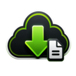

# XBsync

  

**Version 1.0.0**

XBsync is a small Windows app for downloading Xbox cloud saves. It lists what Xbox is holding for a game, downloads the files you want, and saves them to a folder you pick. It's written in C# on .NET 10 with a WinUI 3 interface.

It talks to Xbox's connected-storage service directly and reuses the Xbox sign-in already on your PC where it can, so you usually don't have to type anything in.

## What it does

- Signs in quietly using your local Xbox credentials, with a device-code fallback if that isn't enough.
- Shows your profile, avatar, XUID, and played games, with search, filtering, sorting, and list or grid layouts.
- Lists the save containers and files Xbox holds for a title.
- Downloads the files you pick to a folder you choose, with progress, cancel, and safe names when a file already exists.

## Downloading

1. Open XBsync and let it try to sign in. Click **Sign in** if it needs a hand.
2. Pick a game, then one of its save containers.
3. Choose the files you want and click **Download Selected**. **Open Download Folder** jumps to the last folder you used.

## Things worth knowing

Xbox can refuse a read while you're browsing or downloading, and there is no way to force it. If a download fails partway through, the files that already arrived are kept, so you can retry just the rest.

Your session isn't renewed in the background, so you'll sign in again once it expires.

## Limitations

Not every save can be reached. Some titles appear to protect their save data with extra checks, and Xbox won't hand it over even though the account and container look fine. When that happens there is nothing XBsync can do about it, so those saves simply aren't accessible.

Titles that have never synced to the cloud, or that only keep saves on the console, won't show up at all.

## Credits

By **D3FEKT** - https://github.com/D3FEKT

Authentication - **XboxAuthNet** by AlphaBs - https://github.com/AlphaBs/XboxAuthNet

## Support

XBsync is free and open source. If it has been useful to you, you can buy D3FEKT a coffee on Ko-fi: https://ko-fi.com/d3fekt

## Building

You will need Windows and the .NET 10 SDK:

    dotnet build XBsync.slnx -c Debug -p:Platform=x64 -m:1 -p:BuildInParallel=false

The executable ends up at XBsync/bin/Debug/net10.0-windows10.0.26100.0/win-x64/XBsync.exe.

## Status

Signing in, browsing, and downloading are verified against live Xbox services. The connected-storage protocol it uses is reverse-engineered from local reference code and could change without warning.

## License

XBsync is released under the GNU General Public License v3.0. See [LICENSE](LICENSE) for the full text.
